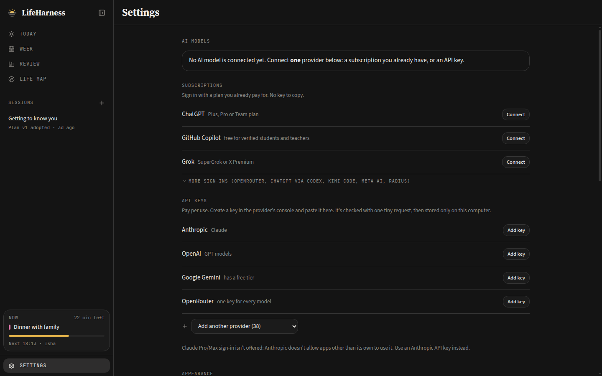
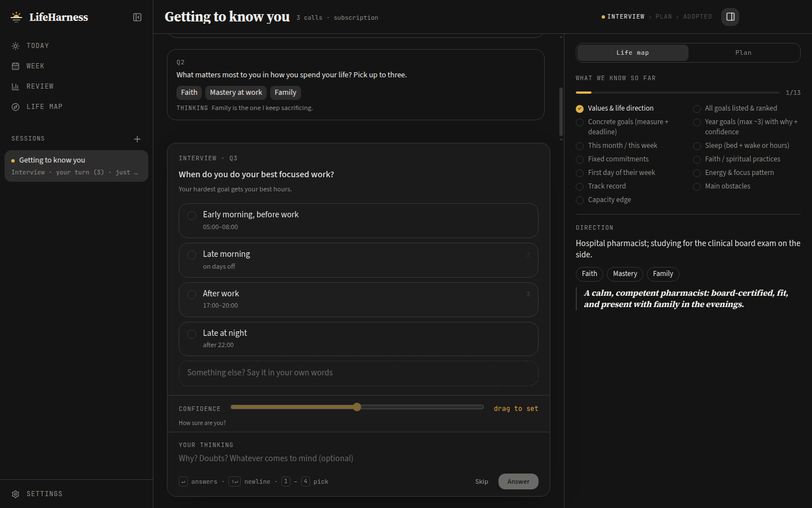
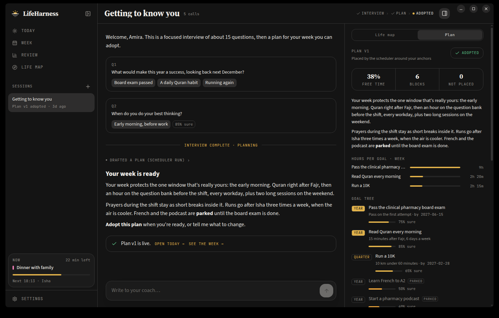
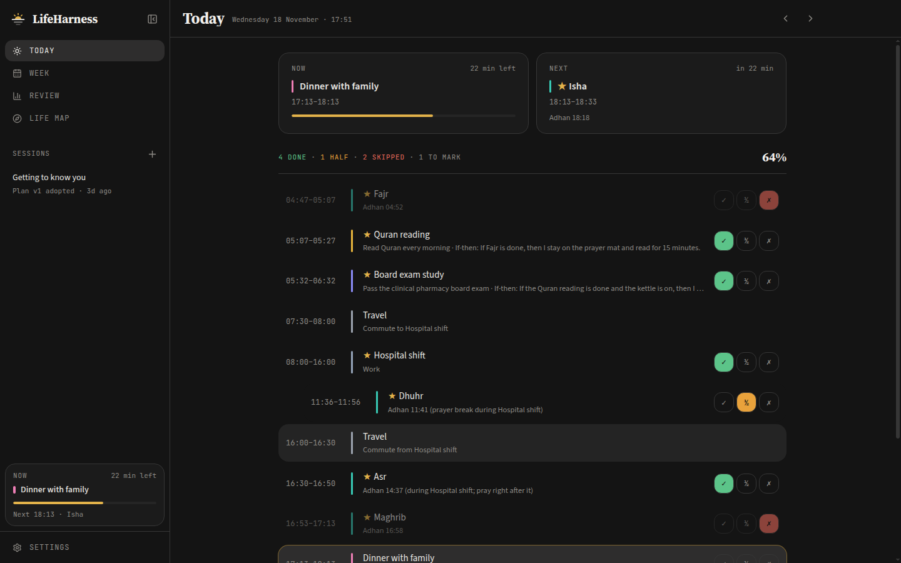
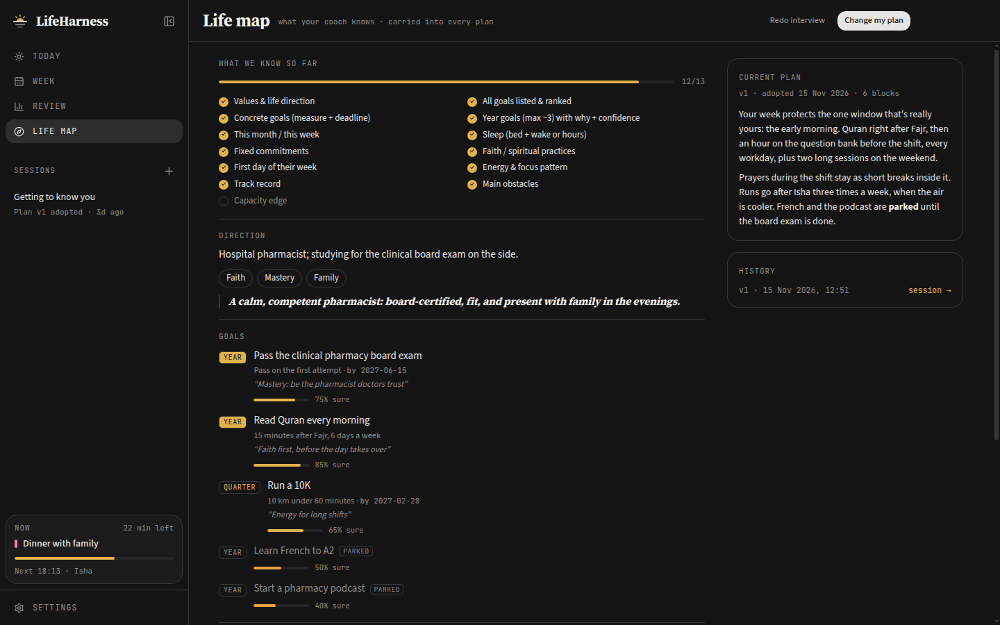
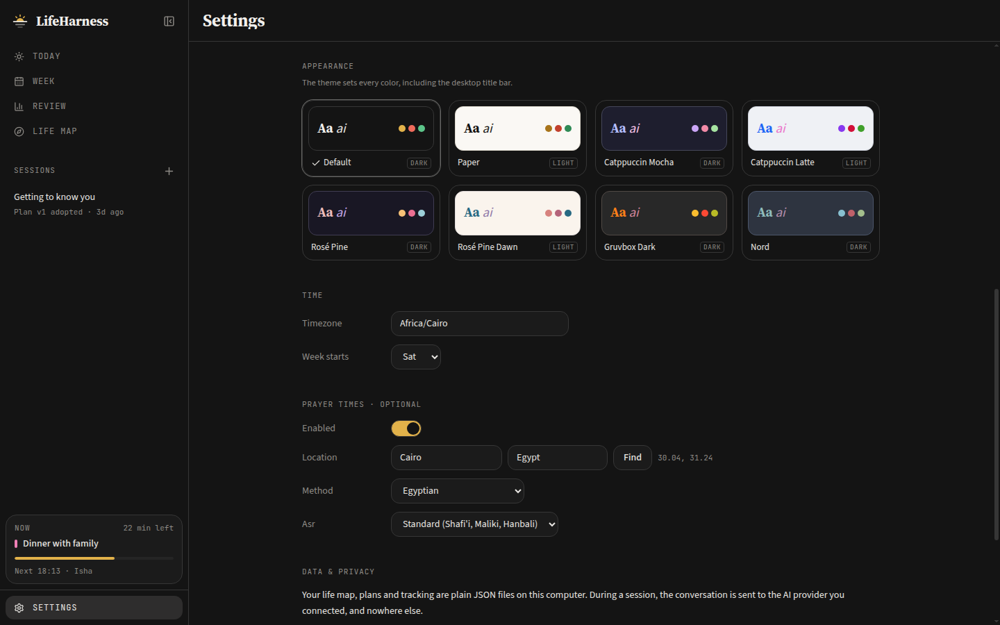

# LifeHarness documentation

The full guide: installing LifeHarness, connecting an AI model, using it day to day, and fixing problems. For a short overview, see the [README](README.md).

**Contents**
- [Install](#install): [Windows](#windows) · [macOS](#macos) · [Linux](#linux) · [Build it yourself](#build-the-installers-yourself) · [Run it in a browser](#or-run-it-in-your-browser)
- [First run: connect an AI model](#first-run-connect-an-ai-model)
- [Using LifeHarness](#using-lifeharness): [the interview](#1-the-interview-about-1520-minutes) · [your plan](#2-your-plan) · [Today](#3-every-day-today) · [the week and your phone's calendar](#4-the-week-and-your-phones-calendar) · [the review](#5-every-week-the-review) · [changing things later](#changing-things-later)
- [Prayer times](#prayer-times-optional)
- [Settings, themes and shortcuts](#settings-themes-and-shortcuts)
- [Your data and privacy](#your-data-and-privacy)
- [Troubleshooting](#troubleshooting)

---

## Install

The latest installers are on the [Releases page](https://github.com/eOvic/LifeHarness/releases/latest). The [README](README.md#download) links to each one directly.

### Windows

Download [LifeHarness-x64-setup.exe](https://github.com/eOvic/LifeHarness/releases/latest/download/LifeHarness-x64-setup.exe) and run it. It installs for your account only (no administrator needed) and adds LifeHarness to the Start menu.

- **"Windows protected your PC":** the installer isn't code-signed yet, so SmartScreen warns about it. Click **More info → Run anyway**.
- **Updating:** run the newer installer. Your data is kept.
- **Removing:** **Settings → Apps → Installed apps → LifeHarness → Uninstall**. Your data stays in `%APPDATA%\LifeHarness` until you delete it.

### macOS

You need macOS 13 (Ventura) or later. Download the disk image for your Mac's chip:
- **Apple silicon** (M1 or newer): [LifeHarness-arm64.dmg](https://github.com/eOvic/LifeHarness/releases/latest/download/LifeHarness-arm64.dmg). **Apple menu → About This Mac** shows "Chip: Apple M…".
- **Intel:** [LifeHarness-x64.dmg](https://github.com/eOvic/LifeHarness/releases/latest/download/LifeHarness-x64.dmg).

Open the disk image and drag LifeHarness into Applications.
- **First open: "Apple could not verify LifeHarness…".** LifeHarness isn't notarized by Apple yet, so macOS asks once. Click **Done**, open **System Settings → Privacy & Security**, scroll down to the message about LifeHarness, click **Open Anyway**, and confirm with your password. After that it opens normally.
- **Run it from Applications.** Opened from the disk image or Downloads, it offers to move itself there. Starting at login needs it.
- **Reminders:** allow notifications when macOS asks, or later in **System Settings → Notifications → LifeHarness**. To check, use **Settings → Reminders → Send a test reminder**. macOS may refuse notifications from an app that Apple hasn't signed; LifeHarness then says so. In that case, get your reminders from a calendar: [Google Calendar sync](#4-the-week-and-your-phones-calendar), or **Export .ics** into Apple Calendar.
- **Menu bar:** while reminders run in the background, LifeHarness has an icon in the menu bar. **⌘Q** quits.
- **Updating:** drag the newer version into Applications and replace the old one. Your data is kept.
- **Removing:** drag LifeHarness from Applications to the Trash. Your data stays in `~/Library/Application Support/LifeHarness` until you delete it.

### Linux

**Ubuntu / Debian (recommended):** download [lifeharness_amd64.deb](https://github.com/eOvic/LifeHarness/releases/latest/download/lifeharness_amd64.deb), install it, then open **LifeHarness** from your app grid.

```bash
sudo apt install ./lifeharness_amd64.deb
```

- **Updating:** quit LifeHarness, then install the newer `.deb` the same way. Your data is kept.
- **Removing:** `sudo apt remove lifeharness`. Your data stays in `~/.config/LifeHarness` until you delete it.

**Any distribution (no install):** download [LifeHarness-x86_64.AppImage](https://github.com/eOvic/LifeHarness/releases/latest/download/LifeHarness-x86_64.AppImage) and run it.

```bash
chmod +x LifeHarness-x86_64.AppImage
./LifeHarness-x86_64.AppImage --no-sandbox   # Ubuntu 24.04+ needs --no-sandbox for AppImages; the .deb doesn't
```

### Build the installers yourself

You need [Node.js](https://nodejs.org) 22 or newer and [Git](https://git-scm.com). Build on the system you're building for:
- **Linux** makes the `.deb` and AppImage.
- **Windows** makes the setup `.exe`.
- **A Mac** makes both `.dmg` files. Without an Apple Developer ID they're signed ad hoc; see [docs/development.md](docs/development.md).

```bash
git clone https://github.com/eOvic/LifeHarness.git && cd LifeHarness
npm install
npm run desktop:build      # installers in dist-desktop/
```

### Or run it in your browser

On any system, in the cloned folder (see above):

```bash
npm install
npm run dev                # then open http://127.0.0.1:3210
```

In browser mode your data goes to the `data/` folder of the project. There are no reminders: those come from the desktop app.

---

## First run: connect an AI model

The coach needs an AI model, from a provider you pick. On first start, LifeHarness asks you to connect one; you can change it any time in **Settings → AI models**. You only need **one**.



| Option | What you need | How |
|---|---|---|
| **Claude** with your Pro, Max, Ultra, Team or Enterprise plan | [Claude Code](https://code.claude.com/docs/en/setup), Anthropic's own app | Install Claude Code, sign in from a terminal with `claude auth login`, then click **Connect** next to Claude. |
| **ChatGPT** (Plus, Pro, Team) | Your ChatGPT account | Click **Connect**. A sign-in page opens in your browser (or click **Open the sign-in page**): approve it, and LifeHarness connects by itself. |
| **GitHub Copilot** (free for verified students and teachers) | A GitHub account with Copilot | Click **Connect**, copy the code shown, click **Open github.com** and enter the code there. |
| **Grok** (SuperGrok, X Premium) | Your xAI or X account | Click **Connect** and enter the code shown on xAI's page. |
| **An API key**: Anthropic, OpenAI, Google Gemini, OpenRouter and about 35 more | A key from the provider's website | Click **Add key**, paste it, click **Save**. The key is tested with one tiny request before it's saved, so a typo shows up right away. |

**What it costs:**
- **Subscriptions** (Claude, ChatGPT, Copilot, Grok) use your plan's allowance.
- **API keys** are billed per use: a full interview is roughly 20 AI calls, about $1–2 with a mid-range model like Claude Sonnet.
- **Daily tracking and the week view** use no AI at all.
- **Free option:** Google Gemini keys have a free tier ([get a key](https://aistudio.google.com/apikey)).

**Why Claude goes through Claude Code:** Anthropic doesn't allow other apps to handle Claude logins. LifeHarness runs *your* Claude Code, which you signed into yourself, so LifeHarness never sees your Claude password or tokens. Claude Code decides how each request is billed: your plan, if you signed in with it.

LifeHarness picks a strong, balanced model for the provider you connect. Under **Settings → AI models** you can choose another model and set **Reasoning** (low, medium or high): lower is faster and cheaper, higher thinks harder.

---

## Using LifeHarness

### 1. The interview (about 15–20 minutes)

Click **Start the interview**. The coach asks about 15 questions, one at a time, covering:
- what matters to you and where you want to be;
- your goals for the year, this month and this week, with how you'll know you've made it;
- your fixed commitments (work, classes), your sleep, and when your energy peaks;
- what you've tried before, and what usually gets in the way.



How to answer:
- **Pick an option** (or several, when allowed), or write your own answer in the box.
- **"Your thinking"** is optional: add doubts, context, or anything that comes to mind. It helps the coach.
- Some questions ask **how sure you are**: drag the slider before answering.
- **Skip** any question you'd rather not answer.
- You can also just type in the message box: the coach treats it as your answer.

Keyboard: **Enter** answers, **Shift+Enter** starts a new line, **1–9** pick an option (outside text boxes).

As you answer, the **Life map** panel on the right fills in with what the coach has learned. You can stop at any time: the session is saved, and the sidebar shows **Your turn** when the coach is waiting for you.

> **Tip:** be honest about what you *actually* kept up last time, not what you hoped. The plan is built on it, and a plan you can keep beats an impressive one.

### 2. Your plan

When it knows enough, the coach builds your plan and explains it. Open the **Plan** tab of the side panel to see:
- **Your goal tree**, from the year down to this week. Goals that wait until later are marked **parked**, so you don't overload yourself.
- **Your week**, with blocks placed around your sleep, commitments, energy and prayers. They never overlap, and at least 15% of your awake time is left free for life.
- **Hours per goal** and anything that didn't fit, with the reason.
- **If-then plans** for your must-do blocks, like "If Fajr is finished, then I sit down and read for 15 minutes." They make starting automatic.



**Want changes?** Say so in plain words in the message box: *"move workouts to the evening"*, *"I can't do anything on Fridays"*, *"make the study blocks shorter"*. The coach redraws the plan.

**Happy with it?** Click **Adopt this plan**. If the button is greyed out, a must-do block doesn't fit yet: ask the coach to adjust. Adopting starts the plan from today, and later changes never rewrite your past days.

### 3. Every day: Today

**Today** shows where you are right now (**Now**, with the time left) and what's **Next**, then all of today's blocks with their times, plus prayer times if you enabled them.



Mark each block as you go:

| Mark | Meaning |
|---|---|
| **✓** | Done |
| **½** | Partly done |
| **✗** | Skipped |

- **Undo a mark:** click it again.
- **Catch up:** use the arrows next to the date to mark yesterday.
- **Be honest:** truthful marks are what the weekly review learns from.

The **Now** card in the sidebar always shows your current block and what's next, from any page.

**Daily tasks** are things you want to do each day without a time slot, like a prayer, drinking water or reading a page. Add one with **Add a daily task…** on Today, or ask the coach ("add Duha as a daily task"). Tick it when it's done; click again to undo. You can also tick yesterday's. The coach can limit a task to some weekdays ("Kahf on Fridays"). Tasks never enter the schedule or the block score: the weekly review shows them separately, as "done on 5 of 7 days".

**Deadlines** are anything due on a date: an exam, homework, an application. Add one on Today with a title and a date, or just mention it to the coach. Today counts them down (amber within a week, red the day before), and LifeHarness reminds you **a week before, the day before and on the day**, at 09:00. Click **✓** when it's handed in. Deadlines also appear as all-day events in Google Calendar sync and in **Export .ics**, with phone alerts a week and a day before.

**Reminders** (desktop app): a notification when each block starts, with its if-then plan, and an evening check-in at 21:30 if some of the day's blocks aren't marked yet. Clicking one opens Today. Blocks you've already marked are skipped.
- **When you close the window,** LifeHarness keeps running in the tray (on macOS, the menu bar), so reminders keep coming. Quit from that icon, or with **⌘Q** on a Mac.
- **To change them, go to Settings → Reminders.** You can get them 5–15 minutes before a block starts, turn on prayer times, move or turn off the check-in, turn off background running, start LifeHarness when you log in, or send a test reminder.
- **Deadlines** get their own reminders, and your **daily tasks** still to tick are listed in the evening check-in.
- **On your phone,** use your calendar: see the next section.

### 4. The week and your phone's calendar

**Week** shows the whole week as a calendar, with each kind of block in its own colour.
- **Click a block** for its details (goal, if-then plan, notes).
- **The side panel** shows hours per category and your unplanned time.
- **Use the arrows** to move between weeks.

To get your plan on your phone, click **Export .ics** and import the file into Google Calendar, Apple Calendar or Outlook. It contains your next 8 weeks. It's a snapshot, so export again after you change your plan.
- **Reminders on the phone:** Apple Calendar and Outlook use the reminders in the file.
- **Google Calendar ignores them.** Import into a separate calendar (for example "LifeHarness") and give that calendar a default notification, such as 5 minutes before.

**Google Calendar sync (optional)** keeps a separate "LifeHarness" calendar in your Google account up to date with your plan: the next 14 days of blocks, each with a reminder that follows **Settings → Reminders**. Your phone then reminds you even when your computer is off, and you never re-export.
- **What goes to Google:** block titles, times and if-then plans. Nothing else from your life map.
- **LifeHarness only touches its own calendar.** It asks for the narrowest permission Google offers (`calendar.app.created`), so it can't read or change your other calendars.
- **When it updates:** when you adopt a plan, change your profile or reminders, every few hours, and on **Sync now**.

To connect, you register your own free Google client once (about 10 minutes). Google reviews apps before they can share one client with everyone; your own client needs no review for your own account.
1. At [console.cloud.google.com](https://console.cloud.google.com), create a project and enable the **Google Calendar API**.
2. In **Google Auth Platform**:
   - **Branding:** any app name, and your email as the support contact.
   - **Audience:** **External**, then **Publish app**. Without that, the connection ends every 7 days.
   - **Data access:** add only `…/auth/calendar.app.created`.
3. Under **Clients**, create a client of type **Desktop app**.
4. In LifeHarness, go to **Settings → Google Calendar**, paste the Client ID and secret, and click **Connect**. Sign in, then continue past "Google hasn't verified this app": it's your own app.

**Disconnect** withdraws the permission and forgets everything stored for Google. The LifeHarness calendar stays in your Google account; delete it there if you no longer want it.

### 5. Every week: the review

**Review** shows how the week went:
- your **week score** and **core score** (your must-do blocks);
- results by day and by block, and your streaks;
- your **weakest block**;
- your **daily tasks**: on how many days each was done.

Click **Review with the coach →** for a short conversation about that block. The coach works through **WOOP** (Wish, Outcome, Obstacle, Plan):
- what you wanted from the block;
- what really got in the way;
- one if-then plan to get past it next week.

If the evidence says the *plan* is the problem rather than your willpower (wrong time of day, too long, too ambitious), the coach proposes a better plan for you to adopt.

### Changing things later

- **The + button next to Sessions** in the sidebar starts:
  - **Change my plan**, when something changed or isn't working;
  - **Weekly review**;
  - **New interview**, to start over from scratch.
- **Life map** shows everything the coach knows about you (direction, goals, your fixed times, plan history), with **Change my plan** and **Redo interview** buttons.



- **Sessions** lists every conversation. Hover over one to delete its transcript; your life map and plans are kept.

---

## Prayer times (optional)

LifeHarness can plan your day around the five daily prayers.
- **Turning it on:** the coach asks during the interview whether any religious or spiritual practice should anchor your schedule. You can also switch it on yourself under **Settings → Prayer times**.
- **Setup:** enter your **city** and **country**, click **Find**, then choose the **calculation method** and the **Asr** convention (Standard or Hanafi).

What it does:
- **Anchors:** prayers become fixed points in your week, and blocks can follow them ("Quran right after Fajr").
- **Sleep:** your bedtime and wake-up can be set relative to a prayer, e.g. "1 hour after Isha".
- **During work or class:** a prayer that falls inside becomes a short break there. If its time window is still open afterwards, it moves to right after.
- **Fridays:** Dhuhr becomes **Jumu'ah**.

Should your local mosque or app differ by a minute or two, ask the coach to adjust ("shift Fajr by 2 minutes"). It can also change how long each prayer block is and how early it starts.

---

## Settings, themes and shortcuts

**Settings** (bottom of the sidebar, **Ctrl+,**, or **⌘,** on a Mac) holds:
- **AI models:** connect or disconnect providers, and pick the model and reasoning level.
- **Appearance:** eight themes, dark and light. The desktop window's buttons follow the theme.
- **Time:** your timezone and the first day of your week.
- **Prayer times:** see [above](#prayer-times-optional).
- **Reminders:** what to be reminded of and when, running in the background, starting at login, and a test reminder.
- **Google Calendar:** connect, sync now, disconnect (see [above](#4-the-week-and-your-phones-calendar)).
- **Data & privacy:** where your files are, with **Open** buttons in the desktop app.



| Shortcut | What it does |
|---|---|
| **Ctrl+B** | Show or hide the sidebar |
| **Ctrl+,** | Open Settings |
| **Enter** / **Shift+Enter** | Answer a question / new line |
| **1–9** | Pick an answer option |
| **Ctrl+Plus** / **Ctrl+Minus** / **Ctrl+0** | Zoom in / out / reset (desktop app) |
| Right-click | Cut, copy, paste and spelling suggestions (desktop app) |

On a Mac, use **⌘** wherever this table says **Ctrl**.

The sidebar hides itself in narrow windows; **Ctrl+B** brings it back, and LifeHarness remembers your choice.

---

## Your data and privacy

**What stays on your computer:**
- **Your life map, plans, tracking and conversations:** plain files readable only by your user account. In the desktop app they're in `~/.config/LifeHarness/data` on Linux, `%APPDATA%\LifeHarness\data` on Windows and `~/Library/Application Support/LifeHarness/data` on macOS (**File → Open data folder**); in browser mode, in the project's `data/` folder.
- **Your sign-ins and API keys:** in `auth.json` in the same `LifeHarness` folder, readable only by you, and never shown in the app. Disconnecting a provider removes its key.
- **While Claude Code works:** it reads a copy of the coaching prompt, which includes your life map, from a private folder inside that same `LifeHarness` folder. The copy is deleted when the run ends, and the app clears any leftovers when it starts.

**What leaves it:**
- **During a conversation:** what you write, and your life map, go to the AI provider you connected, and nowhere else.
- **Prayer times:** the city you type is looked up once on OpenStreetMap, and coordinates are kept to about 1 km.
- **Google Calendar, only if you connect it:** block titles, times and if-then plans for the next 14 days go to the "LifeHarness" calendar in your Google account. The client secret and Google's tokens are stored in `google-calendar.json` beside `auth.json`, readable only by you, and never shown in the app.

**What doesn't happen:** LifeHarness has no analytics and makes no background connections. Its local server only answers your own computer.

**Backups and deleting:**
- **Back up:** copy the data folder.
- **Start fresh:** quit LifeHarness and delete the data folder.
- **Delete one conversation:** use the Sessions page.

---

## Troubleshooting

| Problem | What to do |
|---|---|
| "No AI model is connected" | Connect one in **Settings → AI models** (see [above](#first-run-connect-an-ai-model)). Your session waits and continues once you do. |
| "Claude Code isn't signed in" | In a terminal, run `claude auth login`, then click **Retry**. |
| "Claude Code isn't installed", or Claude won't connect | Install it ([guide](https://code.claude.com/docs/en/setup)) and check that `claude --version` works in a terminal (on Windows, PowerShell), then **Check again**. LifeHarness looks in your PATH and in usual places like `~/.local/bin`. On Windows it finds Anthropic's installer, WinGet, Scoop, Bun and npm installs. On a Mac it also finds Homebrew and npm installs, even when LifeHarness is opened from the Dock. |
| "…usage limit is reached" | Your plan's or account's limit for now. The message says when it resets; you can also switch model in Settings. |
| "…rejected that key" | Copy the whole key again, with no spaces. Check that your provider account has billing or credit set up. |
| ChatGPT sign-in says its port is in use | Another sign-in (for example the Codex CLI) is using it: close that, then try again. |
| The browser doesn't return to LifeHarness after signing in | Copy the address the browser ends on and paste it into the box LifeHarness shows. |
| The AppImage doesn't start | Run it with `--no-sandbox`, or install the `.deb` instead. |
| Windows won't run the installer | SmartScreen blocks unsigned installers at first: click **More info → Run anyway**. |
| macOS: "Apple could not verify LifeHarness…" | It isn't notarized yet. Go to **System Settings → Privacy & Security → Open Anyway**; you only do this once. |
| macOS: "LifeHarness is damaged and can't be opened" | macOS rejected the downloaded copy. In Terminal, run `xattr -dr com.apple.quarantine /Applications/LifeHarness.app`, then open LifeHarness again. |
| No notifications | Check **Settings → Reminders** and your system's Do Not Disturb. On Windows, install with the setup `.exe` (the test zip can't show notifications). On Linux, the tray icon needs your desktop's tray (AppIndicator) support, which Ubuntu has. On a Mac, allow LifeHarness in **System Settings → Notifications**. If it isn't listed there, macOS won't let this unsigned copy notify; use Google Calendar sync or Apple Calendar instead. |
| Closing the window doesn't quit | That keeps reminders coming. Quit from the tray icon (the menu bar on a Mac), with **File → Quit** or **⌘Q**, or turn off **Settings → Reminders → Background**. |
| Google: "Google hasn't verified this app" | Expected for your own client. Click **Advanced → Go to LifeHarness**. |
| Google: the connection ends after a week | Your Google project is still in **Testing**: under **Google Auth Platform → Audience**, click **Publish app**, then connect again. |
| Google: "Calendar API has not been used in project…" | Enable the **Google Calendar API** in that Google Cloud project, wait a minute, then **Sync now**. |
| The app seems stuck | It restarts its own engine if it crashes. If not, quit and reopen. Logs are under **File → Open logs folder** (`~/.config/LifeHarness/logs`, `%APPDATA%\LifeHarness\logs` on Windows, `~/Library/Application Support/LifeHarness/logs` on macOS). |
| A session stopped halfway | Click **Continue** or **Retry** under the conversation. Nothing you answered is lost. |

**Still stuck, or found a bug?** Open an issue on [GitHub](https://github.com/eOvic/LifeHarness/issues), saying what you did and what you saw. Leave out personal details: your plans and conversations stay on your computer unless you paste them.
