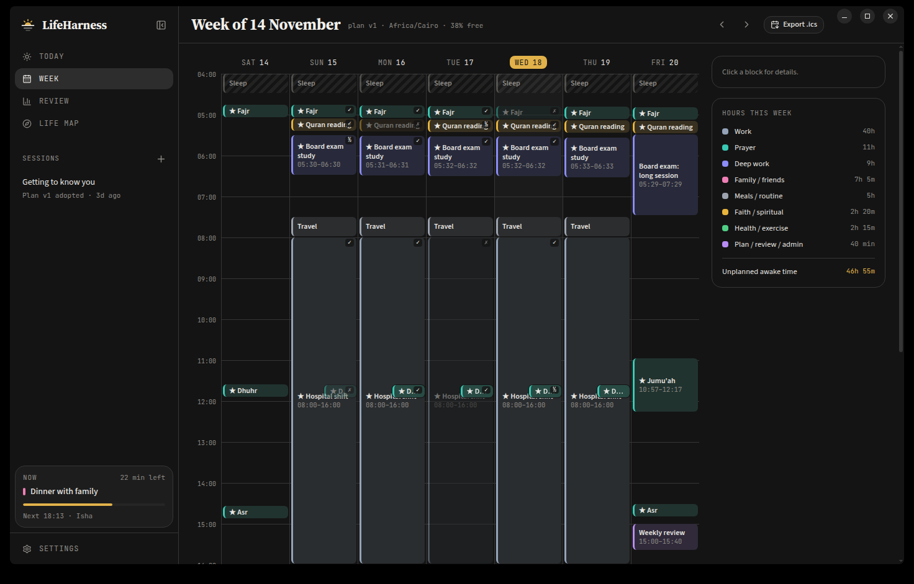

# LifeHarness

**A coach that turns what you want from life into a week you can actually live.**

LifeHarness interviews you, one question at a time, about what matters to you, your goals and how your days really go. Then it builds a realistic weekly plan around your sleep, your work or classes, your energy and, if you want, your prayer times. Each day you tick off what you did; each week it reviews what held and adjusts the plan.

It runs on your own computer. Your plans and history stay there; only the conversation goes to the AI provider you choose.

## Download

| System | Download |
|---|---|
| **Windows** 10 or 11 (64-bit) | [LifeHarness-x64-setup.exe](https://github.com/eOvic/LifeHarness/releases/latest/download/LifeHarness-x64-setup.exe) |
| **macOS** 13 or later, Apple silicon (M1 and newer) | [LifeHarness-arm64.dmg](https://github.com/eOvic/LifeHarness/releases/latest/download/LifeHarness-arm64.dmg) |
| **macOS** 13 or later, Intel | [LifeHarness-x64.dmg](https://github.com/eOvic/LifeHarness/releases/latest/download/LifeHarness-x64.dmg) |
| **Linux**: Ubuntu, Debian | [lifeharness_amd64.deb](https://github.com/eOvic/LifeHarness/releases/latest/download/lifeharness_amd64.deb) |
| **Linux**: any distribution | [LifeHarness-x86_64.AppImage](https://github.com/eOvic/LifeHarness/releases/latest/download/LifeHarness-x86_64.AppImage) |

Older versions and release notes are on the [Releases page](https://github.com/eOvic/LifeHarness/releases). The installers aren't code-signed yet, so Windows and macOS ask you to confirm the first time you open LifeHarness. The steps for each system are in [Install](DOCUMENTATION.md#install).

## How it works

1. **Interview** (15–20 minutes): about 15 questions about your values, your goals for the year, month and week, your fixed commitments, sleep and energy, and what got in the way before.
2. **Plan:** a goal tree and a time-blocked week that fits your real life. Free time is left on purpose, and your must-do blocks get if-then plans. Ask for changes in plain words, then adopt the plan.
3. **Every day:** mark each block **✓** done, **½** partly or **✗** skipped. Reminders tell you when a block starts, on your computer or through your phone's calendar.
4. **Every week:** a review with your scores and your weakest block, then a short conversation that fixes the plan for next week.

## Features

- **Plans you can keep:** the AI decides what matters, and a fixed scheduler places it. Blocks never overlap, and part of every day stays free.
- **Built around your day:** sleep, work or classes and energy peaks, plus optional prayer times calculated for your city.
- **Reminders:** desktop notifications, an evening check-in, an export to any calendar, and optional Google Calendar sync for your phone.
- **The AI you already have:** Claude (through Claude Code), ChatGPT, GitHub Copilot, Grok, or an API key from about 40 providers, including Google Gemini's free tier.
- **Private:** your data stays on your computer. No account, no analytics, no subscription.
- **Free and open source,** for Windows, macOS and Linux.

## Quick start

1. [Download](#download) and install LifeHarness.
2. Connect an AI model on the first screen.
3. Click **Start the interview**.

## Documentation

**[DOCUMENTATION.md](DOCUMENTATION.md)** is the full guide:
- [Install](DOCUMENTATION.md#install): Windows, macOS and Linux, building it yourself, running it in a browser.
- [Connecting an AI model](DOCUMENTATION.md#first-run-connect-an-ai-model), and what it costs.
- [Using LifeHarness](DOCUMENTATION.md#using-lifeharness): the interview, your plan, Today, the week and your phone's calendar, the weekly review.
- [Prayer times](DOCUMENTATION.md#prayer-times-optional).
- [Settings, themes and shortcuts](DOCUMENTATION.md#settings-themes-and-shortcuts).
- [Your data and privacy](DOCUMENTATION.md#your-data-and-privacy).
- [Troubleshooting](DOCUMENTATION.md#troubleshooting).

**For developers:**
- [docs/development.md](docs/development.md): building, testing and packaging.
- [docs/METHODOLOGY.md](docs/METHODOLOGY.md): the coaching method and the research behind it.
- [docs/architecture.md](docs/architecture.md): how it works inside.
- [docs/DESIGN.md](docs/DESIGN.md): the design system.
- [docs/ROADMAP.md](docs/ROADMAP.md): what's next.

Found a bug or have an idea? Open an [issue](https://github.com/eOvic/LifeHarness/issues).

## License

LifeHarness is free software under the [GNU AGPL v3](LICENSE). You may use, study, change and share it, including commercially. If you share a changed version, or run one as a service for other people, you must publish its source code under the same license. It comes with no warranty.

LifeHarness's design follows [LearnHarness](https://github.com/amosblomqvist/learnharness), an AI tutor by Amos Blomqvist, and parts of its Claude Code provider are adapted from LearnHarness's (also AGPL v3). The desktop app includes open-source packages and fonts under their own licenses. Their notices open from **Settings → About → Licenses**.
