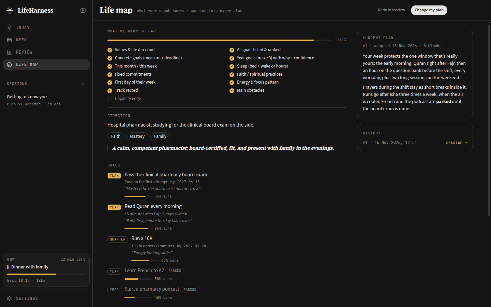
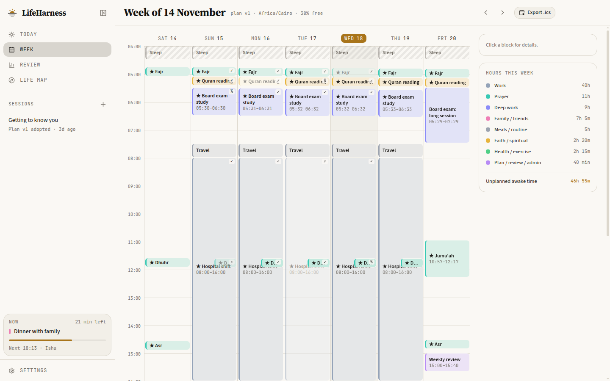
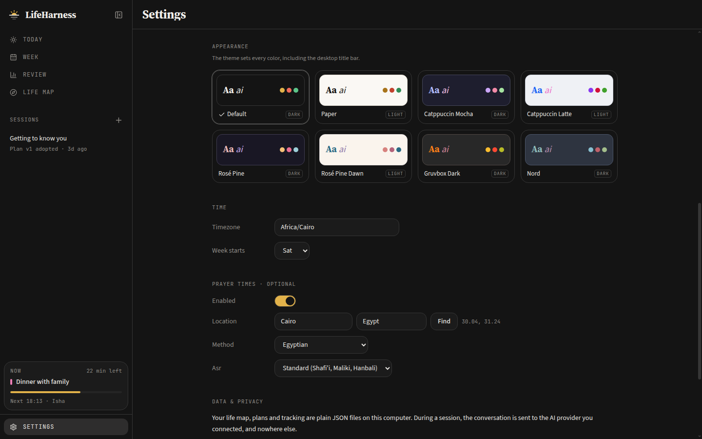

# LifeHarness

**An agent harness for self-development: from what you want in life to a week you can actually live.**

LifeHarness interviews you the way a good coach would, then plans. It works one question at a time and measures two things before it plans anything: where you want to go, and how your days actually run. It then builds the smallest plan that moves every goal you care about, fits that plan around your real constraints, and keeps it honest with tracking and a weekly review.

It's modelled on [LearnHarness](https://github.com/amosblomqvist/learnharness) (measure → plan → teach → practice) and shares its design language, applied to self-development instead of learning.


## How it works

1. **Interview.** About 15 questions, one at a time, each answered with options or your own words, an optional *think out loud* field and, when it matters, a confidence slider. The agent covers:
   - your values and life direction;
   - concrete goals for the year → month → week (each with a measure, a deadline, a why and your confidence);
   - fixed commitments and sleep;
   - optional faith practices, such as prayer times;
   - your energy peak and track record (*what did you actually sustain last time?*);
   - the obstacle that usually wins;
   - the most you'd keep on a bad week.

   Every goal you mention is captured immediately, and your goal list is confirmed and ranked before the interview goes deep on any one goal. A live checklist of strands shows what's still unknown, and the interview can't finish until the scheduler has what it needs.
2. **Plan.** A planner agent designs a goal tree and recurring blocks, and a **deterministic scheduler** places them around your anchors. The scheduler never overlaps blocks, and it reports anything that doesn't fit, with the reason. The planner iterates until every non-negotiable block fits and at least 15% of your awake time stays free, then presents the plan. You adopt it with one click.
3. **Live it.** *Today* and the sidebar's **Now** card show the current block, the time left, and its if-then plan. Mark each block ✓ ½ ✗ in a second. *Week* shows the whole week visually, and **Export .ics** puts it in your phone's calendar.
4. **Review.** Weekly scores (overall and for non-negotiable blocks), streaks and the weakest block. The coach runs WOOP on that block (wish, outcome, real obstacle, if-then plan) and redesigns the plan when the evidence says the *design* is wrong, not your willpower.

| The interview | Your plan, presented | Today |
|---|---|---|
|  |  |  |

| Life map | Light theme (Paper) | 8 themes |
|---|---|---|
|  |  |  |

The method, with the evidence behind each part (goal-setting theory, self-concordance, the planning fallacy, chronotype, implementation intentions, WOOP, progress monitoring), is in **[docs/METHODOLOGY.md](docs/METHODOLOGY.md)**. The visual language is in **[docs/DESIGN.md](docs/DESIGN.md)**.

## Desktop app (Linux)

```bash
npm run desktop:build                                       # → dist-desktop/
sudo apt install ./dist-desktop/lifeharness_0.1.0_amd64.deb  # then open "LifeHarness" from the app grid
# or, without installing:
./dist-desktop/LifeHarness-0.1.0.AppImage --no-sandbox
```

- **The app runs its own local server.** It runs on Electron's own Node, on a private loopback port, with no network listener.
- **Your data stays local.** It's stored in `~/.config/LifeHarness/data` and logs in `~/.config/LifeHarness/logs`. File → *Open data folder* opens them.
- **The `.deb` keeps Chromium's sandbox on.** It installs an AppArmor profile, which Ubuntu 24.04+ requires. The AppImage and dev runs use `--no-sandbox` instead.

**Models.** Connect one AI provider in **Settings → AI models** (the Start page asks on first run):

- **Sign in with a subscription:** ChatGPT (Plus, Pro, Team), GitHub Copilot (free for verified students and teachers) or Grok (SuperGrok, X Premium). More sign-ins are under "More": OpenRouter, ChatGPT via Codex, Kimi, Meta, Radius.
- **Or paste an API key:** Anthropic, OpenAI, Google Gemini (has a free tier), OpenRouter, and about 35 more. Each key is checked with one tiny request before it's saved, so a typo is caught on the spot.
- **Claude is offered through an API key only.** Anthropic doesn't allow third-party apps to use Claude Pro/Max sign-in ([their policy](https://code.claude.com/docs/en/legal-and-compliance)).

LifeHarness picks a strong, balanced model for the provider you connect (for example Claude Sonnet rather than Opus); you can change it, and the reasoning level, in Settings. Credentials live in the app's own file, `~/.config/LifeHarness/auth.json` (readable only by you). LifeHarness never reads pi's credentials. Provider environment variables (`OPENAI_API_KEY`, …) also work.

**Privacy.** Your life map, plans and tracking are stored only on this computer. During a session, the conversation is sent to the AI provider you connected, and nowhere else.

## Develop

```bash
npm install
npm run dev           # the web app at http://127.0.0.1:3210 (loopback only; data in ./data)
npm run desktop       # the same app inside the desktop shell (starts next dev if needed)
npm test              # core maths + agent loop with a scripted model (no network)
npm run typecheck
npm run smoke -- --rounds 30 --keep    # LIVE: a second model plays a persona through interview → plan
npx tsx scripts/ui-e2e.ts              # drives the real UI in Chrome (server must be running)
npm run shots                          # screenshots of every page into ./shots
npm run seed -- /tmp/demo              # deterministic demo data (no model calls) for screenshots and QA
npm run qa:desktop -- --data /tmp/demo # drives the packaged app at 3 window sizes: errors, overflow, screenshots
npx tsx scripts/qa-connections.ts --exe dist-desktop/linux-unpacked/lifeharness   # every connect path, nothing saved
npm run verify:server -- dist-desktop/linux-unpacked/resources/server             # the AI engine shipped whole
```

Useful environment variables:
- `LIFEHARNESS_DATA_DIR`: use a separate data directory (scratch experiments, demos).
- `LIFEHARNESS_AUTH_FILE`: use a separate credentials file.

More documentation:
- [docs/architecture.md](docs/architecture.md): the runtime.
- [docs/DESIGN.md](docs/DESIGN.md): the design system.
- [docs/ROADMAP.md](docs/ROADMAP.md): what's next.

## Layout

```
prompts/        agent doctrine (interviewer, planner, reviewer + shared): edit these to change behaviour
src/core/       pure logic: scheduler, prayer times, themes, profile merge/coverage, report, .ics
src/server/     storage, Pi model runtime, tools, agent loop, plan versions
app/            Next.js pages + API routes
components/     shell + sidebar, question dock, week grid, life map, plan panel, UI primitives
electron/       desktop shell (main + preload); build/ holds the icons, electron-builder.yml the packaging
```
