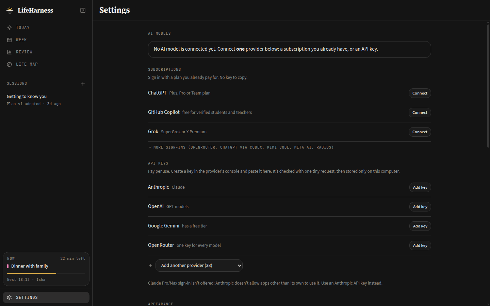
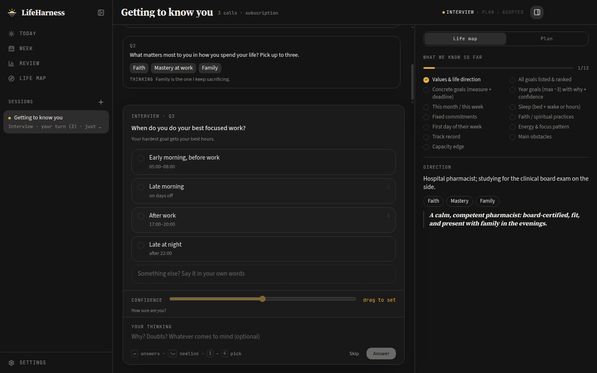
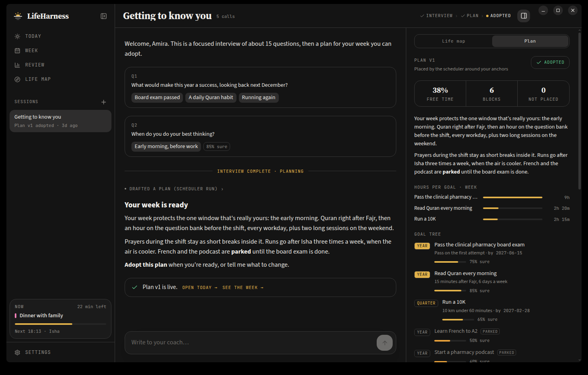

# LifeHarness

**A coach that turns what you want from life into a week you can actually live.**

LifeHarness interviews you, one question at a time: what matters to you, what you want this year, and how your days really go. Then it builds a realistic weekly plan around your sleep, classes or work, your energy and, if you want, your prayer times. Each day you tick off what you did. Each week it reviews what held, finds what didn't, and adjusts the plan.

It runs on your own computer. Your plans and history stay there; only the conversation goes to the AI provider you choose.


**Contents:** [Install](#install) · [Connect an AI model](#first-run-connect-an-ai-model) · [Using LifeHarness](#using-lifeharness) · [Prayer times](#prayer-times-optional) · [Settings and shortcuts](#settings-themes-and-shortcuts) · [Your data and privacy](#your-data-and-privacy) · [Troubleshooting](#troubleshooting) · [For developers](#for-developers)

---

## Install

### Linux desktop app

**Ubuntu / Debian (recommended):** install the `.deb`, then open **LifeHarness** from your app grid.

```bash
sudo apt install ./lifeharness_0.3.0_amd64.deb     # your version number may differ
```

- **Updating:** quit LifeHarness, then install the newer `.deb` the same way. Your data is kept.
- **Removing:** `sudo apt remove lifeharness`. Your data stays in `~/.config/LifeHarness` until you delete it.

**Any Linux (no install):** run the AppImage.

```bash
chmod +x LifeHarness-0.3.0.AppImage
./LifeHarness-0.3.0.AppImage --no-sandbox   # Ubuntu 24.04+ needs --no-sandbox for AppImages; the .deb doesn't
```

### Build the installers yourself

You need [Node.js](https://nodejs.org) 22 or newer.

```bash
git clone <repository-url> lifeharness && cd lifeharness
npm install
npm run desktop:build      # creates dist-desktop/lifeharness_<version>_amd64.deb and an AppImage
```

### Or run it in your browser (any system)

```bash
npm install
npm run dev                # then open http://127.0.0.1:3210
```

In browser mode your data goes to the `data/` folder of the project. Desktop builds are Linux-only for now, so macOS and Windows users run it this way.

---

## First run: connect an AI model

The coach needs an AI model, from a provider you pick. On first start, LifeHarness asks you to connect one; you can change it any time in **Settings → AI models**. You only need **one**.



| Option | What you need | How |
|---|---|---|
| **Claude** with your Pro, Max, Ultra, Team or Enterprise plan | [Claude Code](https://code.claude.com/docs/en/setup), Anthropic's own app | Install Claude Code, sign in from a terminal with `claude auth login`, then click **Connect** next to Claude. |
| **ChatGPT** (Plus, Pro, Team) | Your ChatGPT account | Click **Connect**. A sign-in page opens in your browser (or click **Open the sign-in page**): approve it, and LifeHarness connects by itself. |
| **GitHub Copilot** (free for verified students and teachers) | A GitHub account with Copilot | Click **Connect**, copy the code shown, click **Open github.com** and enter the code there. |
| **Grok** (SuperGrok, X Premium) | Your xAI or X account | Click **Connect** and enter the code shown on xAI's page. |
| **An API key**: Anthropic, OpenAI, Google Gemini, OpenRouter and about 35 more | A key from the provider's website | Click **Add key**, paste it, click **Save**. The key is tested with one tiny request before it's saved, so a typo shows up right away. |

**What it costs:**
- **Subscriptions** (Claude, ChatGPT, Copilot, Grok) use your plan's allowance.
- **API keys** are billed per use: a full interview is roughly 20 AI calls, about $1–2 with a mid-range model like Claude Sonnet.
- **Daily tracking and the week view** use no AI at all.
- **Free option:** Google Gemini keys have a free tier ([get a key](https://aistudio.google.com/apikey)).

**Why Claude goes through Claude Code:** Anthropic doesn't allow other apps to handle Claude logins. LifeHarness runs *your* Claude Code, which you signed into yourself, so LifeHarness never sees your Claude password or tokens. Claude Code decides how each request is billed: your plan, if you signed in with it.

LifeHarness picks a strong, balanced model for the provider you connect. Under **Settings → AI models** you can choose another model and set **Reasoning** (low, medium or high): lower is faster and cheaper, higher thinks harder.

---

## Using LifeHarness

### 1. The interview (about 15–20 minutes)

Click **Start the interview**. The coach asks about 15 questions, one at a time, covering:
- what matters to you and where you want to be;
- your goals for the year, this month and this week, with how you'll know you've made it;
- your fixed commitments (work, classes), your sleep, and when your energy peaks;
- what you've tried before, and what usually gets in the way.



How to answer:
- **Pick an option** (or several, when allowed), or write your own answer in the box.
- **"Your thinking"** is optional: add doubts, context, or anything that comes to mind. It helps the coach.
- Some questions ask **how sure you are**: drag the slider before answering.
- **Skip** any question you'd rather not answer.
- You can also just type in the message box: the coach treats it as your answer.

Keyboard: **Enter** answers, **Shift+Enter** starts a new line, **1–9** pick an option (outside text boxes).

As you answer, the **Life map** panel on the right fills in with what the coach has learned. You can stop at any time: the session is saved, and the sidebar shows **Your turn** when the coach is waiting for you.

> **Tip:** be honest about what you *actually* kept up last time, not what you hoped. The plan is built on it, and a plan you can keep beats an impressive one.

### 2. Your plan

When it knows enough, the coach builds your plan and explains it. Open the **Plan** tab of the side panel to see:
- **Your goal tree**, from the year down to this week. Goals that wait until later are marked **parked**, so you don't overload yourself.
- **Your week**, with blocks placed around your sleep, commitments, energy and prayers. They never overlap, and at least 15% of your awake time is left free for life.
- **Hours per goal** and anything that didn't fit, with the reason.
- **If-then plans** for your must-do blocks, like "If Fajr is finished, then I sit down and read for 15 minutes." They make starting automatic.



**Want changes?** Say so in plain words in the message box: *"move workouts to the evening"*, *"I can't do anything on Fridays"*, *"make the study blocks shorter"*. The coach redraws the plan.

**Happy with it?** Click **Adopt this plan**. If the button is greyed out, a must-do block doesn't fit yet: ask the coach to adjust. Adopting starts the plan from today, and later changes never rewrite your past days.

### 3. Every day: Today

**Today** shows where you are right now (**Now**, with the time left) and what's **Next**, then all of today's blocks with their times, plus prayer times if you enabled them.


Mark each block as you go:

| Mark | Meaning |
|---|---|
| **✓** | Done |
| **½** | Partly done |
| **✗** | Skipped |

- **Undo a mark:** click it again.
- **Catch up:** use the arrows next to the date to mark yesterday.
- **Be honest:** truthful marks are what the weekly review learns from.

The **Now** card in the sidebar always shows your current block and what's next, from any page.

### 4. The week and your phone's calendar

**Week** shows the whole week as a calendar, with each kind of block in its own colour.
- **Click a block** for its details (goal, if-then plan, notes).
- **The side panel** shows hours per category and your unplanned time.
- **Use the arrows** to move between weeks.

To get your plan on your phone, click **Export .ics** and import the file into Google Calendar, Apple Calendar or Outlook. It contains your next 8 weeks. It's a snapshot, so export again after you change your plan.

### 5. Every week: the review

**Review** shows how the week went:
- your **week score** and **core score** (your must-do blocks);
- results by day and by block, and your streaks;
- your **weakest block**.

Click **Review with the coach →** for a short conversation about that block. The coach works through **WOOP** (Wish, Outcome, Obstacle, Plan):
- what you wanted from the block;
- what really got in the way;
- one if-then plan to get past it next week.

If the evidence says the *plan* is the problem rather than your willpower (wrong time of day, too long, too ambitious), the coach proposes a better plan for you to adopt.

### Changing things later

- **The + button next to Sessions** in the sidebar starts:
  - **Change my plan**, when something changed or isn't working;
  - **Weekly review**;
  - **New interview**, to start over from scratch.
- **Life map** shows everything the coach knows about you (direction, goals, your fixed times, plan history), with **Change my plan** and **Redo interview** buttons.


- **Sessions** lists every conversation. Hover over one to delete its transcript; your life map and plans are kept.

---

## Prayer times (optional)

LifeHarness can plan your day around the five daily prayers.
- **Turning it on:** the coach asks during the interview whether any religious or spiritual practice should anchor your schedule. You can also switch it on yourself under **Settings → Prayer times**.
- **Setup:** enter your **city** and **country**, click **Find**, then choose the **calculation method** and the **Asr** convention (Standard or Hanafi).

What it does:
- **Anchors:** prayers become fixed points in your week, and blocks can follow them ("Quran right after Fajr").
- **Sleep:** your bedtime and wake-up can be set relative to a prayer, e.g. "1 hour after Isha".
- **During work or class:** a prayer that falls inside becomes a short break there. If its time window is still open afterwards, it moves to right after.
- **Fridays:** Dhuhr becomes **Jumu'ah**.

Should your local mosque or app differ by a minute or two, ask the coach to adjust ("shift Fajr by 2 minutes"). It can also change how long each prayer block is and how early it starts.

---

## Settings, themes and shortcuts

**Settings** (bottom of the sidebar, or **Ctrl+,**) holds:
- **AI models:** connect or disconnect providers, and pick the model and reasoning level.
- **Appearance:** eight themes, dark and light. The desktop window's buttons follow the theme.
- **Time:** your timezone and the first day of your week.
- **Prayer times:** see [above](#prayer-times-optional).
- **Data & privacy:** where your files are, with **Open** buttons in the desktop app.


| Shortcut | What it does |
|---|---|
| **Ctrl+B** | Show or hide the sidebar |
| **Ctrl+,** | Open Settings |
| **Enter** / **Shift+Enter** | Answer a question / new line |
| **1–9** | Pick an answer option |
| **Ctrl+Plus** / **Ctrl+Minus** / **Ctrl+0** | Zoom in / out / reset (desktop app) |
| Right-click | Cut, copy, paste and spelling suggestions (desktop app) |

The sidebar hides itself in narrow windows; **Ctrl+B** brings it back, and LifeHarness remembers your choice.

---

## Your data and privacy

**What stays on your computer:**
- **Your life map, plans, tracking and conversations:** plain files readable only by your user account. In the desktop app they're in `~/.config/LifeHarness/data` (**File → Open data folder**); in browser mode, in the project's `data/` folder.
- **Your sign-ins and API keys:** in `~/.config/LifeHarness/auth.json`, readable only by you, and never shown in the app. Disconnecting a provider removes its key.

**What leaves it:**
- **During a conversation:** what you write, and your life map, go to the AI provider you connected, and nowhere else.
- **Prayer times:** the city you type is looked up once on OpenStreetMap, and coordinates are kept to about 1 km.

**What doesn't happen:** LifeHarness has no analytics and makes no background connections. Its local server only answers your own computer.

**Backups and deleting:**
- **Back up:** copy the data folder.
- **Start fresh:** quit LifeHarness and delete the data folder.
- **Delete one conversation:** use the Sessions page.

---

## Troubleshooting

| Problem | What to do |
|---|---|
| "No AI model is connected" | Connect one in **Settings → AI models** (see [above](#first-run-connect-an-ai-model)). Your session waits and continues once you do. |
| "Claude Code isn't signed in" | In a terminal, run `claude auth login`, then click **Retry**. |
| "Claude Code isn't installed", or Claude won't connect | Install it ([guide](https://code.claude.com/docs/en/setup)) and check that `claude --version` works in a terminal, then **Check again**. LifeHarness looks in your PATH and in usual places like `~/.local/bin`. |
| "…usage limit is reached" | Your plan's or account's limit for now. The message says when it resets; you can also switch model in Settings. |
| "…rejected that key" | Copy the whole key again, with no spaces. Check that your provider account has billing or credit set up. |
| ChatGPT sign-in says its port is in use | Another sign-in (for example the Codex CLI) is using it: close that, then try again. |
| The browser doesn't return to LifeHarness after signing in | Copy the address the browser ends on and paste it into the box LifeHarness shows. |
| The AppImage doesn't start | Run it with `--no-sandbox`, or install the `.deb` instead. |
| The app seems stuck | It restarts its own engine if it crashes. If not, quit and reopen. Logs are under **File → Open logs folder** (`~/.config/LifeHarness/logs`). |
| A session stopped halfway | Click **Continue** or **Retry** under the conversation. Nothing you answered is lost. |

---

## For developers

How LifeHarness is built, tested and packaged is in **[docs/development.md](docs/development.md)**. Further reading:
- [docs/METHODOLOGY.md](docs/METHODOLOGY.md): the coaching method and the research behind it.
- [docs/architecture.md](docs/architecture.md): how it works inside.
- [docs/DESIGN.md](docs/DESIGN.md): the design system.
- [docs/ROADMAP.md](docs/ROADMAP.md): what's next.

LifeHarness's design follows [LearnHarness](https://github.com/amosblomqvist/learnharness), an AI tutor built on the same idea of measuring before planning.
