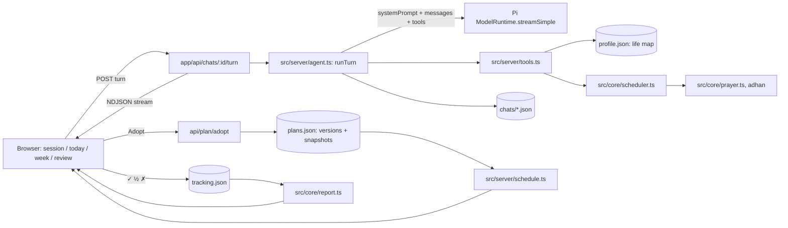

# Architecture

LifeHarness is a Next.js app. The server owns the agent turns, storage and scheduling; the browser renders projections of them. The model layer is the Pi engine (`@earendil-works/pi-ai` + `pi-coding-agent`'s `ModelRuntime`), which is also what LearnHarness is built on.

## Code layout

| Path | Role |
|---|---|
| `src/core/` | Pure domain logic, no IO: types, time maths, prayer times, **scheduler**, profile merge + coverage, tracking report, `.ics` export |
| `src/server/` | Storage (JSON files), model runtime, prompt composition, tools, the agent loop, plan adoption, the view projection |
| `prompts/` | Agent doctrine: `base.md`, `intake.md` (interviewer), `planner.md`, `review.md`, and the `shared/` fragments |
| `app/` | Next.js pages and API routes |
| `components/` | The question dock, week grid, life map, plan panel |
| `tests/` | vitest: core maths, plus the agent loop with a scripted model (no network) |
| `scripts/` | `smoke-agent.ts` (a live model plays a persona end to end), `ui-e2e.ts` (drives the browser), `screenshots.ts` |

## Agent turns

A **turn** is one input from the person, followed by model calls until the agent asks a question or stops.

1. **Apply the input.**
   - A first `start`, a message, or an answer to the open question.
   - An answer becomes the `toolResult` of the `ask_question` call that asked it.
   - A typed message while a question is open counts as that question's answer.
2. **Call the model** with the system prompt for the current phase and that phase's tools:
   - `intake`: ask_question, update_profile, intake_done
   - `plan`: ask_question, update_profile, propose_plan, add_if_then
   - `review`: ask_question, update_profile, propose_plan, add_if_then, add_lesson
3. **Execute server tools** immediately. Arguments are validated against the JSON schemas; invalid calls return an error the model can correct.
   - `ask_question` pauses the turn. Only one question per turn: a second question in the same message is rejected.
4. **Hand off.** `intake_done` succeeds only when the required strands are covered. It switches the conversation to the planner, which continues in the same turn, mirroring LearnHarness's prober → teacher handoff.
5. **Save as you go.** Every model call is saved. A failed call can be retried (`continue`).

The browser receives NDJSON events:
- `status`
- `text` (deltas)
- `tool`
- `chat` (a full view snapshot)
- `error`
- `done`

## The system prompt

The system prompt is assembled from three parts, in this order:
1. The static doctrine: base + phase file + shared fragments.
2. The live context: the date and time, the life map as JSON, the open strands, the adopted plan, and, in a review, the week's tracking report.

## The scheduler

This is the deterministic core: the LLM proposes block *specs*, and code places them. Each day is filled in this order:

1. **Sleep.** A bed rule and a wake rule, or a bed rule plus a number of hours. Rules may be relative to a prayer (`{anchor: "isha", offsetMin: 80}`). Sleep may cross midnight.
2. **Fixed commitments,** with optional travel before and after.
3. **Prayers** (optional, via `adhan`):
   - Each prayer block starts 5 minutes before the adhan.
   - Friday Dhuhr becomes Jumu'ah.
   - A prayer inside a commitment moves to right after it *only if its window (up to the next adhan) is still open*, counting travel. Otherwise it becomes an overlay: a prayer break inside the commitment.
   - A Fajr that falls during sleep splits the sleep.
4. **Flexible blocks.**
   - Placement order: anchored blocks first (`after` / `before` a reference: wake, bed, a prayer, `block:<id>` or `fixed:<id>`; or `fill` the gap between two), then core blocks, then by priority, energy and length.
   - A block anchored to another block is always placed after it (topological order).
   - Days are explicit, or chosen by `timesPerWeek` with workdays first, falling back to the days with the most free time.
   - Each block lands in the earliest free slot inside its window. A `before` anchor takes the latest slot instead.
5. **Report.** Blocks that couldn't be placed are reported with the reason (e.g. "no free 90-min slot in 06:00–10:00, largest gap 45 min"), together with:
   - free time per day and as a percentage of awake time;
   - hours per goal and per category;
   - any overlap warnings.

## Plans and history

`plans.json` holds immutable versions. Each version stores:
- the goal tree and blocks;
- a **snapshot** of the scheduling-relevant profile.

For a past date, the version in force on that date is used; future dates use the latest version. Adopting a new plan therefore never rewrites earlier days or how they were tracked.

## Storage

Everything is plain JSON under `LIFEHARNESS_DATA_DIR` (default `./data`):

| File | Contents |
|---|---|
| `profile.json` | The life map |
| `plans.json` | Plan versions |
| `tracking.json` | `date → block key → {status, title, core, category}` |
| `chats/*.json` | Native Pi messages, the open question, answers, the latest proposal, usage |
| `settings.json` | The chosen model and reasoning level |

Writes go to a temp file and are then renamed into place. One server process should own a data directory.

## Desktop shell

`electron/main.cjs` turns the web app into a desktop app the same way LearnHarness does.

**Packaged startup.** The shell:
1. picks a free `127.0.0.1` port;
2. spawns `resources/server/server.js` (the Next **standalone** build) with `process.execPath` and `ELECTRON_RUN_AS_NODE=1`, so no separate Node install is needed;
3. sets `LIFEHARNESS_DATA_DIR=<userData>/data`, `LIFEHARNESS_AUTH_FILE=<userData>/auth.json`, the per-launch `LIFEHARNESS_API_SECRET` and the version. `<userData>` is `~/.config/LifeHarness`, `%APPDATA%\LifeHarness` or `~/Library/Application Support/LifeHarness`;
4. polls `/api/health`, then loads the app;
5. if the server dies, restarts it on the same port and reloads the window (gives up with a dialog after 3 exits in a minute);
6. on quit, stops the server. Its process is named `next-server (v16…)`, not `lifeharness`.

Logs (`main.log`, `server.log`) rotate past 5 MB. A right-click menu provides cut/copy/paste, spelling suggestions and link actions (Electron has none by default). Settings' "Open" buttons ask the shell to open the data, config or logs folder by name; the page can't pass a path.

**Dev mode.** `npm run desktop` runs `scripts/desktop-dev.mjs`, which starts or reuses `next dev` (on 127.0.0.1), warms up its routes, and opens the shell with `LIFEHARNESS_DEV_URL`. Run only one `next dev` per checkout: two servers sharing `.next/dev` put the page in an endless "HMR hash mismatch" reload. If a dev page ever reloads in a loop, restart `next dev`.

**Window.** It's frameless:
- On Linux and Windows, `titleBarOverlay` draws the native buttons in the theme's colors. The renderer reports theme changes through the preload bridge (`window.lifeharness.setChrome`).
- The page's 60px headers are the drag region, and `env(titlebar-area-*)` keeps their content clear of the buttons.
- On macOS the traffic lights sit top-left (`titleBarStyle: "hiddenInset"`, at 18,22). The leftmost header band leaves them 88px: the sidebar's, or the page's while the sidebar is hidden (`.lh-traffic`). The server marks `<html data-chrome="mac">` for the first frame. Menus and dialogs follow the theme's light or dark (`nativeTheme`).
- The background matches the theme, and the window shows on `ready-to-show`.
- Size and position are persisted.

**Security.**
- `contextIsolation`, `sandbox: true`, no Node in the page.
- Permission requests are denied, except clipboard writes.
- Navigation is pinned to the app's origin, and external links open in the default browser.

**Packaging.** `npm run desktop:build`:
1. builds the standalone server (`LIFEHARNESS_STANDALONE=1 next build`);
2. assembles the server and ships the AI engine **whole**: Next's file tracing only follows static imports, and pi loads its sign-in flows and provider SDKs lazily, so tracing alone shipped about a quarter of it (the first packaged build failed at the first model call). `scripts/server-deps.mjs` copies the full production dependency closure of the external packages, and `scripts/verify-server.mjs` checks it twice (staging folder, then the packaged app): every file present, and every pi-ai module importable from inside the server folder;
3. stages a dependency-free app folder (`desktop-app/`: main, preload, login item, icons);
4. runs electron-builder. Its `afterPack` hook:
   - copies the server, including its `node_modules` and Turbopack's relative symlinks, into the resources folder (`resources/server`, or `LifeHarness.app/Contents/Resources/server` on macOS);
   - keeps only that OS's prebuilt native add-ons;
   - writes the licenses;
5. outputs:
   - on Linux: a `.deb` (with an AppArmor profile for Ubuntu 24.04+'s user-namespace restriction) and an AppImage;
   - on Windows: a per-user NSIS installer;
   - on macOS: a `.dmg` per chip.

**macOS.** Built on a Mac: GitHub's Apple silicon runner makes both the arm64 and x64 disk images. electron-builder runs `afterPack` before signing, so everything copied into the app is covered by its signature.
- **Signing:** without an Apple Developer ID, the app is signed ad hoc (`mac.identity=-`), because Apple silicon only runs signed code; macOS then asks for **Open Anyway** once. With `CSC_LINK` and the `APPLE_*` notary variables, electron-builder signs with the Developer ID (hardened runtime) and notarizes. `signIgnore` keeps fonts, images and WebAssembly from being signed one by one: they're sealed like any resource.
- **Second Dock icon:** Next sets `process.title`, and in Electron's Node mode on macOS that registers the server with Launch Services as the app itself, so a second icon appeared in the Dock. The shell starts the server with `--require server-title-guard.cjs`, which keeps the title in JavaScript (adapted from LearnHarness).
- **Menus:** an app menu with **Settings… ⌘,** and a Dock menu (Today, Week). The menu bar icon is a template image (`trayTemplate.png`, @2x), which macOS tints.
- **Start at login:** a LaunchAgent (`~/Library/LaunchAgents/dev.lifeharness.desktop.plist`, `electron/login-item.cjs`), because `app.setLoginItemSettings` can't pass `--background` there, and Electron warns it can fail for an app that isn't notarized. It's only written while the app runs from Applications. An app run from Downloads or the disk image gets a temporary path, so on first open the app offers to move itself to Applications.
- **Notifications:** Electron uses Apple's UNNotification API, which refuses an app it can't verify. A refused notification emits `failed`. The shell records it, and Settings → Reminders explains it and points to the calendar options. **Send a test reminder** checks it on demand.
- **Claude Code:** an app opened from the Dock gets only `/usr/bin:/bin:/usr/sbin:/sbin` on its PATH. A script-based install (npm's `#!/usr/bin/env node`) is started with its own folder first on PATH, then Homebrew's and `/usr/local`'s.

## Credentials and model choice

LifeHarness owns its credentials. `src/server/llm.ts` creates pi's `ModelRuntime` with `<config>/auth.json` and `<config>/models.json`, where `<config>` is `~/.config/LifeHarness` (the desktop app's userData; `LIFEHARNESS_CONFIG_DIR` / `LIFEHARNESS_AUTH_FILE` override). It never reads or writes `~/.pi`. Provider environment variables also count as connections.

**Connecting** (`src/server/connections.ts`, Settings → AI models) goes through pi's own `login(provider, "oauth" | "api_key", interaction)`:
- A sign-in is a *login job*. pi drives the flow; its prompts ("paste the redirect URL", "enterprise domain?") and events (open this URL, enter this device code) stream to the page as NDJSON from `POST /api/connections/login`, and answers come back on `POST /api/connections/login/<job>`. Closing the stream cancels the job (freeing callback ports such as 1455).
- An API key is cleaned (no whitespace; keys starting with `!` are refused, because pi runs those as shell commands), then tested with one tiny request while held in memory only (`setRuntimeApiKey`). A key the provider rejects is never saved.
- Claude Pro/Max sign-in is not offered directly (Anthropic doesn't allow third-party apps to use it); Claude plans work through Claude Code instead (below), and Claude API keys work as usual.
- After a connect, the app adopts the provider's recommended model unless a working model was already picked. Recommendations favour each provider's strong, balanced model (`PREFERENCES` in `llm.ts`; e.g. the newest Sonnet, not Opus).

**Errors** a person can act on: `errors.ts` maps provider failures (rejected key, quota, network, overload, missing engine files) to one sentence and an action (`connect` or `retry`). Sessions keep the raw text as detail. A turn that can't start because nothing is connected returns 503 with `action: "connect"`, and the session shows the connect panel, then re-sends the same input once a model is connected.

## Reminders

The server decides what to remind, and the desktop shell shows it.
- **The rules** live in `src/core/reminders.ts`, a pure module, tested directly:
  - plan blocks at their start (or 5–15 minutes before), with the if-then plan;
  - prayers, when they're wanted;
  - an evening check-in, only while some of the day's tracked blocks are unmarked;
  - nothing for fixed commitments, sleep or blocks already marked.
- **`GET /api/reminders`** lists the next 36 hours, for today and tomorrow in the profile's timezone.
- **`electron/main.cjs` schedules them.**
  - It polls every 5 minutes, on wake and unlock, and when the page saves settings or adopts a plan (`refreshShell`).
  - It sets a timer for anything due within the hour.
  - Just before showing a reminder, it asks again, so a block marked meanwhile, or a changed plan, never sends a stale one.
  - After sleep, reminders more than 2 minutes late are dropped rather than sent in a burst.
- **The shell keeps running in the background** (the tray icon) while any reminder is on, so closing the window doesn't stop them. It says so the first time.
- **"Start when I log in"** is opt-in. It uses an autostart entry on Linux and a login item on Windows, both starting with `--background`.

## Google Calendar sync

`src/server/google-calendar.ts` is optional and off until you connect. It keeps a "LifeHarness" calendar in step with the plan.
- **The client is yours.** You register a Google Cloud OAuth client (type Desktop app) and enter it in Settings. A client shared with everyone would need Google's app review first.
- **One scope,** `calendar.app.created`: make secondary calendars, and manage events only on those.
- **Sign-in** is OAuth 2.0 for installed apps, with PKCE (S256) and a one-shot listener on 127.0.0.1. The listener ignores anything without the right `state`, and times out after 10 minutes. Google is asked for `access_type=offline` and `prompt=consent`, so a refresh token always comes back.
- **Storage:** `<private folder>/google-calendar.json`, written 0600. It holds the client, the tokens, the calendar's id and the last sync. The page's status has none of the secrets, and nothing goes to the logs.
- **Sync** covers the next 14 days.
  - `src/core/calendar-events.ts` decides the events: plan blocks, plus prayers when prayer reminders are on, with a popup reminder that follows Settings → Reminders.
  - Each event gets a stable id (`lh` + a hash of `<date>:<block key>`) and a content hash, so a pass only writes what changed.
  - Events you deleted in Google come back (insert → 409 → update), and a deleted calendar is created again.
  - Days before today, and events without LifeHarness's key, are never touched.
- **Triggers:** connecting, adopting a plan, saving the profile or reminders (`syncSoon`, debounced), a 6-hour rolling check, and "Sync now". Passes run one at a time.
- **Failures** become a plain message in Settings:
  - **A withdrawn permission** (`invalid_grant`) clears the tokens and says to connect again.
  - **Network errors** say Google couldn't be reached; the next pass retries.
- **Tests** run against a fake Google (`tests/google-calendar.test.ts`). Endpoint overrides are accepted only on 127.0.0.1.

## Claude through Claude Code

Claude plans can't be connected directly (Anthropic forbids third-party Claude sign-in and handling plan credentials), but Anthropic allows running the **unmodified Claude Code** that the person signed into themselves. `src/server/claude-code.ts` makes it a model provider, following the design of LearnHarness's external-CLI provider, and adapting parts of its code (AGPL-3.0, like LifeHarness):

- **Opt-in, version-only status.** Settings → AI models → Claude → Connect turns it on. LifeHarness checks only `claude --version` (minimum 2.1.259): no auth-status command, no account details, no credential files, no model call. Install, sign-in and billing stay Claude Code's (`claude auth login`).
- **One isolated process per conversation, without a shell**, in an empty temporary folder:
  - flags: `--system-prompt-file` (our prompt), `--tools ""`, `--disable-slash-commands`, `--no-session-persistence`, `--permission-prompts none`, `--strict-mcp-config`;
  - your *user* settings still load (`--setting-sources user`), so sign-in and routing work as you configured them, while `--settings` turns off hooks and pins the default output style, and `CLAUDE_CODE_DISABLE_CLAUDE_MDS=1` keeps CLAUDE.md memory out;
  - the environment is yours minus what LifeHarness itself set (its request secret).
- **Tools through an authenticated bridge** (`claude-code-bridge.ts`): a private MCP server (Streamable HTTP) on 127.0.0.1 per process, bearer-token protected, its tools pre-approved with `--allowedTools`. A streamed tool call is only an *intent*; it runs when the matching MCP call arrives (same `claudecode/toolUseId`, name and arguments). Anything else (a refusal, a mismatch, moving on early) fails closed. Nothing runs from stdout alone.
- **Held calls, live processes.** The bridge holds each call until LifeHarness has the result (even the person's answer to a question), and the process stays alive, so the conversation continues natively with real tool results. Reuse requires the same conversation (chat id), instructions, tools, model, effort and environment, and the exact history so far. The system prompt's live context (clock, life map, open strands; after `LIVE_CONTEXT_MARKER`) may change: the update travels with the next tool result. After 10 idle minutes, a restart or any other change, the next call starts a fresh process that replays the history as labelled text.
- **Billing** shows as "via Claude Code"; its client-side dollar estimates aren't imported.
- **Privacy.** The prompt (with the life map) and the bridge config (with its token) are written 0600 to private folders inside the app's own folder (`claude-code/runs/<server pid>-…/`, never the system temp folder, which Windows never cleans). They're removed when the process ends and when the server exits. At start-up, folders of servers that are gone, and older versions' `lifeharness-claude-*` temp folders, are removed (`claude-runs.ts`). Claude Code keeps no session file of these conversations.
- **Tests** drive a fake `claude` that streams tool calls and calls them back over the bridge like the real CLI (`tests/claude-code.test.ts`), including the real agent loop across saved turns. `LIFEHARNESS_DEBUG_CLAUDE=1` logs why a held process was or wasn't reused; `LIFEHARNESS_CLAUDE_BIN` points at another binary.

## Local server security

The server holds the life map and the credentials, so `proxy.ts` (Next 16's middleware) guards every request:
1. **Loopback only.** `Host` must be `localhost`, `127.x.x.x` or `[::1]`, which defeats DNS rebinding. `npm run dev` / `npm start` also bind to 127.0.0.1, never the LAN.
2. **Same-origin writes.** Non-GET requests from another site (`Sec-Fetch-Site`, `Origin`) are refused, which stops CSRF.
3. **Content-Security-Policy** on every page: scripts, styles, images, fonts and fetches from the app's own origin only (no remote images: nothing the model writes can carry data out through an image URL), `frame-ancestors 'none'`, `no-referrer`.
4. **Desktop secret.** The Electron shell generates a random secret per launch, passes it to the server (`LIFEHARNESS_API_SECRET`), and adds it as a header to requests for the app's own origin only (it strips it from everything else, including redirects). Without it, every route except `/api/health` answers 403, so other users and processes on the machine can't use the API.

**Privacy defaults.** Data files are written 0600 in 0700 folders. Coordinates are rounded to ~1 km (they reach the AI with the profile). pi's background catalog refresh from pi.dev is off (`PI_OFFLINE=1` unless `LIFEHARNESS_MODEL_CATALOG=online`). The desktop build replaces the build machine's project path in Next's embedded config, names a neutral maintainer (`LIFEHARNESS_MAINTAINER` to override), and `scripts/privacy-check.mjs` fails the build if the builder's home path, user name or any configured git email (repo or global) appears anywhere in the package.
