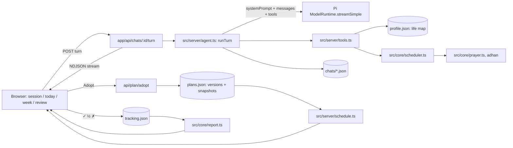

# Architecture

LifeHarness is a Next.js app. The server owns the agent turns, storage and scheduling; the browser renders projections of them. The model layer is the Pi engine (`@earendil-works/pi-ai` + `pi-coding-agent`'s `ModelRuntime`), which is also what LearnHarness is built on.

## Code layout

| Path | Role |
|---|---|
| `src/core/` | Pure domain logic, no IO: types, time maths, prayer times, **scheduler**, profile merge + coverage, tracking report, `.ics` export |
| `src/server/` | Storage (JSON files), model runtime, prompt composition, tools, the agent loop, plan adoption, the view projection |
| `prompts/` | Agent doctrine: `base.md`, `intake.md` (interviewer), `planner.md`, `review.md`, and the `shared/` fragments |
| `app/` | Next.js pages and API routes |
| `components/` | The question dock, week grid, life map, plan panel |
| `tests/` | vitest: core maths, plus the agent loop with a scripted model (no network) |
| `scripts/` | `smoke-agent.ts` (a live model plays a persona end to end), `ui-e2e.ts` (drives the browser), `screenshots.ts` |

## Agent turns

A **turn** is one input from the person, followed by model calls until the agent asks a question or stops.

1. **Apply the input.**
   - A first `start`, a message, or an answer to the open question.
   - An answer becomes the `toolResult` of the `ask_question` call that asked it.
   - A typed message while a question is open counts as that question's answer.
2. **Call the model** with the system prompt for the current phase and that phase's tools:
   - `intake`: ask_question, update_profile, intake_done
   - `plan`: ask_question, update_profile, propose_plan, add_if_then
   - `review`: ask_question, update_profile, propose_plan, add_if_then, add_lesson
3. **Execute server tools** immediately. Arguments are validated against the JSON schemas; invalid calls return an error the model can correct.
   - `ask_question` pauses the turn. Only one question per turn: a second question in the same message is rejected.
4. **Hand off.** `intake_done` succeeds only when the required strands are covered. It switches the conversation to the planner, which continues in the same turn, mirroring LearnHarness's prober → teacher handoff.
5. **Save as you go.** Every model call is saved. A failed call can be retried (`continue`).

The browser receives NDJSON events:
- `status`
- `text` (deltas)
- `tool`
- `chat` (a full view snapshot)
- `error`
- `done`

## The system prompt

The system prompt is assembled from three parts, in this order:
1. The static doctrine: base + phase file + shared fragments.
2. The live context: the date and time, the life map as JSON, the open strands, the adopted plan, and, in a review, the week's tracking report.

## The scheduler

This is the deterministic core: the LLM proposes block *specs*, and code places them. Each day is filled in this order:

1. **Sleep.** A bed rule and a wake rule, or a bed rule plus a number of hours. Rules may be relative to a prayer (`{anchor: "isha", offsetMin: 80}`). Sleep may cross midnight.
2. **Fixed commitments,** with optional travel before and after.
3. **Prayers** (optional, via `adhan`):
   - Each prayer block starts 5 minutes before the adhan.
   - Friday Dhuhr becomes Jumu'ah.
   - A prayer inside a commitment moves to right after it *only if its window (up to the next adhan) is still open*, counting travel. Otherwise it becomes an overlay: a prayer break inside the commitment.
   - A Fajr that falls during sleep splits the sleep.
4. **Flexible blocks.**
   - Placement order: anchored blocks first (`after` / `before` a reference: wake, bed, a prayer, `block:<id>` or `fixed:<id>`; or `fill` the gap between two), then core blocks, then by priority, energy and length.
   - A block anchored to another block is always placed after it (topological order).
   - Days are explicit, or chosen by `timesPerWeek` with workdays first, falling back to the days with the most free time.
   - Each block lands in the earliest free slot inside its window. A `before` anchor takes the latest slot instead.
5. **Report.** Blocks that couldn't be placed are reported with the reason (e.g. "no free 90-min slot in 06:00–10:00, largest gap 45 min"), together with:
   - free time per day and as a percentage of awake time;
   - hours per goal and per category;
   - any overlap warnings.

## Plans and history

`plans.json` holds immutable versions. Each version stores:
- the goal tree and blocks;
- a **snapshot** of the scheduling-relevant profile.

For a past date, the version in force on that date is used; future dates use the latest version. Adopting a new plan therefore never rewrites earlier days or how they were tracked.

## Storage

Everything is plain JSON under `LIFEHARNESS_DATA_DIR` (default `./data`):

| File | Contents |
|---|---|
| `profile.json` | The life map |
| `plans.json` | Plan versions |
| `tracking.json` | `date → block key → {status, title, core, category}` |
| `chats/*.json` | Native Pi messages, the open question, answers, the latest proposal, usage |
| `settings.json` | The chosen model and reasoning level |

Writes go to a temp file and are then renamed into place. One server process should own a data directory.

## Credentials

`ModelRuntime.create()` reuses pi's `~/.pi/agent/auth.json` (an API key or a subscription login) and provider environment variables. Set `LIFEHARNESS_AUTH_FILE` to use a separate file. Model choice and reasoning level are set in Settings.
